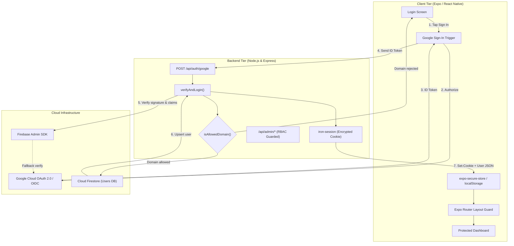
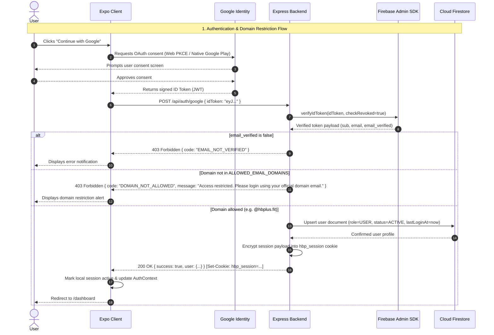
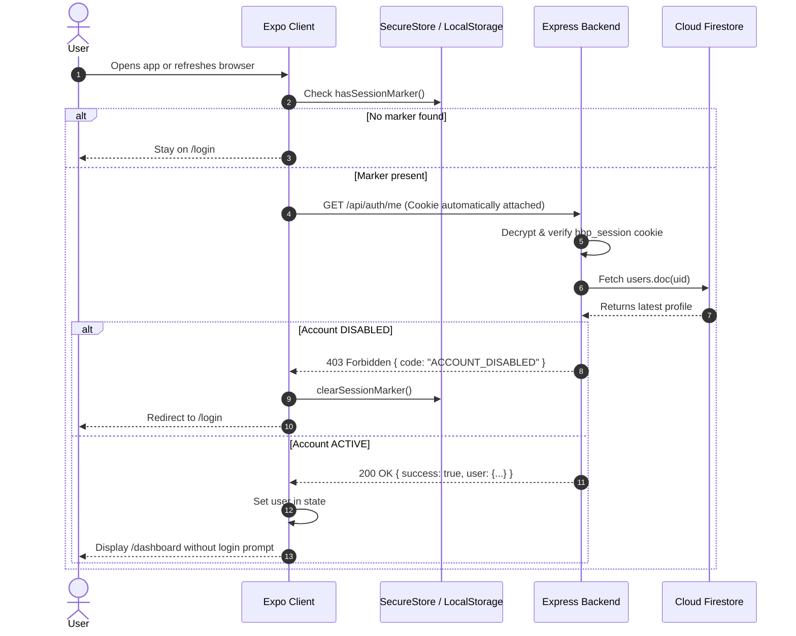

# Horizon Portal — Cross-Platform Domain-Restricted Authentication Platform

> Enterprise-grade authentication portal and protected dashboard built with **React Native (Expo)**, **React Native for Web**, and a secure **Node.js/Express** backend. Access is strictly restricted to verified Google Workspace email addresses from authorised domains (e.g. `@hbplus.fit`).

---

## Table of Contents

- [Horizon Portal — Cross-Platform Domain-Restricted Authentication Platform](#horizon-portal--cross-platform-domain-restricted-authentication-platform)
  - [Table of Contents](#table-of-contents)
  - [Overview](#overview)
    - [Problem Solved](#problem-solved)
  - [Key Features](#key-features)
  - [Architecture \& Tech Stack](#architecture--tech-stack)
    - [Technology Breakdown](#technology-breakdown)
  - [Project Directory Structure](#project-directory-structure)
  - [Setup Instructions](#setup-instructions)
    - [Prerequisites](#prerequisites)
    - [Step 1: Install Dependencies](#step-1-install-dependencies)
    - [Step 2: Google Cloud Console Setup](#step-2-google-cloud-console-setup)
      - [Configure OAuth Consent Screen](#configure-oauth-consent-screen)
      - [Create OAuth 2.0 Credentials](#create-oauth-20-credentials)
        - [A. Web Application Client](#a-web-application-client)
        - [B. Android Client](#b-android-client)
        - [C. iOS Client](#c-ios-client)
    - [Step 3: Firebase Console Setup](#step-3-firebase-console-setup)
      - [Enable Google Authentication](#enable-google-authentication)
      - [Register Web App](#register-web-app)
      - [Initialize Cloud Firestore](#initialize-cloud-firestore)
      - [Generate Service Account Private Key](#generate-service-account-private-key)
    - [Step 4: Environment Variables](#step-4-environment-variables)
      - [Frontend Environment (`.env` in repo root)](#frontend-environment-env-in-repo-root)
      - [Backend Environment (`backend/.env`)](#backend-environment-backendenv)
    - [Step 5: Run the Application](#step-5-run-the-application)
      - [Terminal 1 — Start the Backend Server](#terminal-1--start-the-backend-server)
      - [Terminal 2 — Start the Client Portal](#terminal-2--start-the-client-portal)
  - [Authentication Flow](#authentication-flow)
    - [1. Successful Login (Authorised Domain)](#1-successful-login-authorised-domain)
    - [2. Unauthorised Domain Rejection](#2-unauthorised-domain-rejection)
    - [3. Session Persistence \& Rehydration](#3-session-persistence--rehydration)
    - [4. Session Invalidation \& Expiration](#4-session-invalidation--expiration)
    - [5. Sign Out](#5-sign-out)
    - [Web vs. Native OAuth Implementation](#web-vs-native-oauth-implementation)
  - [How Domain Restriction Works](#how-domain-restriction-works)
    - [Zero-Trust Server-Side Boundary](#zero-trust-server-side-boundary)
    - [Domain Extraction \& Normalisation](#domain-extraction--normalisation)
    - [Exact Match Validation](#exact-match-validation)
    - [Attack Vector Prevention](#attack-vector-prevention)
    - [Configuring Allowed Domains](#configuring-allowed-domains)
      - [Single Domain](#single-domain)
      - [Multiple Domains](#multiple-domains)
  - [Role-Based Access Control (RBAC) \& Database Schema](#role-based-access-control-rbac--database-schema)
    - [Database Schema (`users` collection in Firestore)](#database-schema-users-collection-in-firestore)
    - [RBAC Guards](#rbac-guards)
  - [API Reference](#api-reference)
    - [Authentication Endpoints](#authentication-endpoints)
      - [1. Google Login](#1-google-login)
      - [2. Get Current Session](#2-get-current-session)
      - [3. Logout](#3-logout)
    - [Dashboard \& Admin Endpoints](#dashboard--admin-endpoints)
      - [4. Get Dashboard Data](#4-get-dashboard-data)
      - [5. List Users (Admin)](#5-list-users-admin)
      - [6. Update User Role (Admin)](#6-update-user-role-admin)
  - [Testing \& Verification](#testing--verification)
    - [Running Automated Backend Tests](#running-automated-backend-tests)
    - [Manual Verification Matrix](#manual-verification-matrix)
  - [Troubleshooting](#troubleshooting)
    - [1. `redirect_uri_mismatch` in Google OAuth Popup](#1-redirect_uri_mismatch-in-google-oauth-popup)
    - [2. Android Sign-In Fails or Closes Immediately](#2-android-sign-in-fails-or-closes-immediately)
    - [3. Backend Error: `Missing or invalid service account`](#3-backend-error-missing-or-invalid-service-account)
    - [4. CORS Errors on Web Login](#4-cors-errors-on-web-login)

---

## Overview

The **Horizon Portal** is an internal corporate portal system designed to give team members secure, seamless access to internal company resources and user profiles using their existing Google Workspace identities.

### Problem Solved

Public Google Sign-In lets _any_ person with a `@gmail.com` or personal account generate valid Google OAuth tokens. Typical frontend-only guards can be bypassed by spoofing client state or calling backend endpoints directly.

The **Horizon Portal** solves this by establishing a **strict zero-trust server-side security perimeter**:

- Users authenticate via Google OAuth 2.0.
- Google ID tokens are verified cryptographically on the Node.js backend.
- The user's email domain is extracted from the verified cryptographic payload and evaluated against an allowlist (`ALLOWED_EMAIL_DOMAINS`).
- Only verified accounts with exact domain matches (e.g., `user@hbplus.fit`) are admitted and issued an encrypted session.
- Any other domain (e.g., `user@gmail.com`) is rejected immediately with the standard error:
  > _"Access restricted. Please login using your official domain email."_

---

## Key Features

- **Cross-Platform Single Codebase**: Runs seamlessly on desktop/mobile browsers (React Native for Web), Android devices/emulators, and iOS devices/simulators.
- **Login Portal Screen**: Clean, responsive, minimal UI featuring official Google Sign-In button, branded layout, dynamic authorized domain hint, and inline error dismissals.
- **Protected Dashboard**: Accessible exclusively after server authorization. Features user profile avatar, personalized welcome, email address, role badge (`USER` / `ADMIN`), membership date, last login timestamp, and sign-out controls.
- **Strict Server-Side Domain Restriction**: Zero client-side trust; domain evaluation is performed on the backend against server configuration.
- **Encrypted Session Management**: Uses `iron-session` with encrypted, `HttpOnly`, `SameSite=strict` cookies on web, paired with secure persistent session markers (`expo-secure-store` on native, `localStorage` on web) for instant session rehydration.
- **Role-Based Access Control (RBAC)**: Supports `USER` and `ADMIN` roles. Roles are stored securely in Cloud Firestore and can only be modified through backend admin endpoints.
- **Just-In-Time (JIT) Provisioning**: First-time authorized users are automatically provisioned in Firestore with active status. Subsequent logins update access timestamps without altering assigned permissions.
- **Route Protection**: Expo Router layout guards prevent unauthenticated direct navigation to protected routes and automatically redirect authenticated sessions away from the login screen.

---

## Architecture & Tech Stack



### Technology Breakdown

| Component                | Technology                                  | Role                                             |
| ------------------------ | ------------------------------------------- | ------------------------------------------------ |
| **Frontend Framework**   | React Native 0.76 + Expo SDK 52             | Unified cross-platform UI logic                  |
| **Web Runtime**          | React Native for Web 0.19                   | Compiles React Native components to DOM          |
| **Routing & Navigation** | Expo Router v4                              | File-based protected & public route groups       |
| **Mobile Google Auth**   | `@react-native-google-signin/google-signin` | Native Google Play Services / iOS SDK auth       |
| **Web Google Auth**      | `expo-auth-session`                         | Web OAuth popup / redirect flow with PKCE        |
| **Client Storage**       | `expo-secure-store` / `localStorage`        | Rehydration session presence marker              |
| **Backend Server**       | Node.js + Express + TypeScript              | Authoritative security and business API          |
| **Token Verification**   | `firebase-admin` + `google-auth-library`    | Verifies cryptographic token signatures & claims |
| **Session Engine**       | `iron-session`                              | Stateless, sealed, encrypted HTTP-only cookies   |
| **User Store**           | Google Cloud Firestore                      | Persistent storage of user accounts and roles    |
| **Validation**           | `zod`                                       | Runtime schema validation for env and payloads   |

---

## Project Directory Structure

```
hbp/
├── app/                              # Expo Router application routes
│   ├── _layout.tsx                   # Root layout with AuthProvider & SafeArea
│   ├── index.tsx                     # Entry redirect (dashboard if logged in, else login)
│   ├── (auth)/                       # Public unauthenticated routes
│   │   ├── _layout.tsx               # Redirects to /dashboard if already logged in
│   │   └── login.tsx                 # Portal login page with Google button
│   ├── (protected)/                  # Protected routes (requires valid session)
│   │   ├── _layout.tsx               # Redirects to /login if unauthenticated
│   │   └── dashboard.tsx             # Portal user dashboard & profile view
│   └── auth/callback.tsx             # Web OAuth redirect handler
├── src/                              # Frontend source code
│   ├── components/                   # Shared UI components (Avatar, LoadingScreen, etc.)
│   ├── constants/config.ts           # Client environment variable consumer
│   ├── features/
│   │   ├── authentication/           # Auth state, services, hooks, and UI components
│   │   │   ├── components/           # GoogleSignInButton, AuthErrorMessage
│   │   │   ├── services/             # googleAuth (native & web), authApi
│   │   │   ├── types/                # User, AuthState, Error interfaces
│   │   │   └── utils/                # sessionStorage adapter
│   │   └── dashboard/                # Dashboard components (RoleBadge)
│   └── providers/
│       └── AuthProvider.tsx          # React Context managing auth lifecycle
├── backend/                          # Node.js Express server
│   ├── src/
│   │   ├── app.ts                    # Express app configuration & middlewares
│   │   ├── server.ts                 # Server entry point (starts on port 4000)
│   │   ├── config/
│   │   │   ├── env.ts                # Zod environment validation
│   │   │   └── firebase.ts           # Firebase Admin & Firestore initialization
│   │   ├── middleware/
│   │   │   ├── authenticate.ts       # Iron-session verification & req.user attachment
│   │   │   ├── requireRole.ts        # RBAC role check middleware
│   │   │   └── errorHandler.ts       # Centralized error handler
│   │   ├── modules/
│   │   │   ├── auth/                 # Auth router, controller, and verification service
│   │   │   └── admin/                # Admin user listing & role mutation
│   │   └── utils/
│   │       ├── domain.ts             # Domain extraction & allowlist validation
│   │       └── errors.ts             # Custom domain error types
│   ├── tests/                        # Backend unit & integration tests
│   ├── package.json
│   └── tsconfig.json
├── firestore.rules                   # Firestore database security rules
├── app.json                          # Expo project metadata & native plugin configs
└── README.md                         # Documentation
```

---

## Setup Instructions

### Prerequisites

Ensure you have the following installed on your machine:

- **Node.js**: v18.0.0 or higher (v20+ recommended)
- **npm**: v9 or higher
- **Git**
- A **Google Cloud Platform** account (with billing enabled if required)
- A **Firebase Console** account

---

### Step 1: Install Dependencies

```bash
# 1. Install frontend dependencies
npm install

# 2. Install backend dependencies
cd backend && npm install && cd ..
```

---

### Step 2: Google Cloud Console Setup

1. Open the [Google Cloud Console](https://console.cloud.google.com).
2. Create a new project (e.g. `hbplus-portal`). Note your **Project ID**.

#### Configure OAuth Consent Screen

1. Go to **APIs & Services → OAuth consent screen**.
2. Select User Type:
   - **Internal**: If your Google Cloud project is within your Google Workspace organization (recommended; auto-restricts access to workspace members).
   - **External**: If using a personal account for testing. (Add all test email addresses under _Test users_).
3. Fill in the App Name (`Horizon Portal`), User Support Email, and Developer Email.
4. Add the following scopes:
   - `openid`
   - `https://www.googleapis.com/auth/userinfo.email`
   - `https://www.googleapis.com/auth/userinfo.profile`
5. Save and continue.

#### Create OAuth 2.0 Credentials

Navigate to **APIs & Services → Credentials → + Create Credentials → OAuth client ID**.

You will create **three client IDs**:

##### A. Web Application Client

- **Application type**: `Web application`
- **Name**: `Horizon Web Portal`
- **Authorized JavaScript origins**:
  - `http://localhost:8081`
  - `http://localhost:19006`
- **Authorized redirect URIs**:
  - `http://localhost:8081/auth/callback`
  - `https://<YOUR-FIREBASE-PROJECT-ID>.firebaseapp.com/__/auth/handler`
- Save and record the generated **Client ID**.

##### B. Android Client

- **Application type**: `Android`
- **Name**: `Horizon Android`
- **Package name**: `com.hbplus.app`
- **SHA-1 certificate fingerprint**:
  Run this command locally to get your debug keystore SHA-1:
  ```bash
  keytool -list -v \
    -keystore ~/.android/debug.keystore \
    -alias androiddebugkey \
    -storepass android \
    -keypass android | grep SHA1
  ```
- Save and record the Android Client ID.

##### C. iOS Client

- **Application type**: `iOS`
- **Name**: `Horizon iOS`
- **Bundle ID**: `com.hbplus.app`
- Save and record the iOS Client ID, as well as the **iOS URL scheme** (the reversed client ID).
- In `app.json`, paste the reversed client ID into:
  ```json
  "plugins": [
    [
      "@react-native-google-signin/google-signin",
      {
        "iosUrlScheme": "com.googleusercontent.apps.YOUR-REVERSED-CLIENT-ID"
      }
    ]
  ]
  ```

---

### Step 3: Firebase Console Setup

1. Open the [Firebase Console](https://console.firebase.google.com).
2. Click **Add project** and choose the existing Google Cloud project created in Step 2 (`hbplus-portal`).

#### Enable Google Authentication

1. Go to **Build → Authentication → Sign-in method**.
2. Click **Add new provider** → select **Google** → click **Enable**.
3. Choose your project support email and click **Save**.

#### Register Web App

1. Go to **Project Settings (Gear Icon) → General**.
2. Under _Your apps_, click the **Web (`</>`)** icon.
3. Register the app as `Horizon Web`.
4. Note the provided `apiKey`, `authDomain`, and `projectId`.

#### Initialize Cloud Firestore

1. Go to **Build → Firestore Database → Create database**.
2. Choose **Production mode** and choose a server region closest to your users.
3. Once created, click on the **Rules** tab, paste the contents of `firestore.rules`, and click **Publish**:
   ```javascript
   rules_version = '2';
   service cloud.firestore {
     match /databases/{database}/documents {
       match /users/{uid} {
         allow read: if request.auth != null && request.auth.uid == uid;
         allow write: if false; // All writes must go through the Node.js Admin SDK
       }
       match /{document=**} {
         allow read, write: if false;
       }
     }
   }
   ```

#### Generate Service Account Private Key

1. Go to **Project Settings → Service Accounts**.
2. Click **Generate new private key** and download the resulting JSON file.
3. Store this file securely on your machine (e.g. `/home/user/service-account.json`).
   > ⚠️ **Security Warning**: Never commit this file or include it in git history.

---

### Step 4: Environment Variables

#### Frontend Environment (`.env` in repo root)

Copy `.env.example` to `.env`:

```bash
cp .env.example .env
```

Populate the values:

```env
# Google OAuth Client IDs (from Step 2)
EXPO_PUBLIC_GOOGLE_WEB_CLIENT_ID=YOUR_WEB_CLIENT_ID.apps.googleusercontent.com
EXPO_PUBLIC_GOOGLE_ANDROID_CLIENT_ID=YOUR_ANDROID_CLIENT_ID.apps.googleusercontent.com
EXPO_PUBLIC_GOOGLE_IOS_CLIENT_ID=YOUR_IOS_CLIENT_ID.apps.googleusercontent.com

# Firebase Web Config (from Step 3)
EXPO_PUBLIC_FIREBASE_API_KEY=AIzaSy...
EXPO_PUBLIC_FIREBASE_AUTH_DOMAIN=hbplus-portal.firebaseapp.com
EXPO_PUBLIC_FIREBASE_PROJECT_ID=hbplus-portal

# Backend API URL (Use http://10.0.2.2:4000 for Android emulator)
EXPO_PUBLIC_API_BASE_URL=http://localhost:4000

# Optional domain hint displayed on login page (comma-separated)
EXPO_PUBLIC_ALLOWED_DOMAINS=hbplus.fit
```

#### Backend Environment (`backend/.env`)

Copy `backend/.env.example` to `backend/.env`:

```bash
cp backend/.env.example backend/.env
```

Populate the values:

```env
# Domain restriction allowlist (comma-separated, exact match)
ALLOWED_EMAIL_DOMAINS=hbplus.fit

# Session secret (min 32 random characters)
# Generate with: node -e "console.log(require('crypto').randomBytes(32).toString('hex'))"
SESSION_SECRET=a_very_long_cryptographically_secure_random_string_32_chars_min
SESSION_MAX_AGE=28800

# Firebase project ID and Web Client ID (matches frontend)
FIREBASE_PROJECT_ID=hbplus-portal
GOOGLE_WEB_CLIENT_ID=YOUR_WEB_CLIENT_ID.apps.googleusercontent.com

# Absolute path to the downloaded service account JSON
GOOGLE_APPLICATION_CREDENTIALS=/absolute/path/to/service-account.json

# Server configuration
PORT=4000
NODE_ENV=development
CORS_ORIGINS=http://localhost:8081,http://localhost:19006
```

---

### Step 5: Run the Application

#### Terminal 1 — Start the Backend Server

```bash
cd backend
npm run dev
```

The server will boot on `http://localhost:4000`. You can verify it via `curl http://localhost:4000/health` (returns `{"status":"ok"}`).

#### Terminal 2 — Start the Client Portal

```bash
# Run web portal in browser (default: http://localhost:8081)
npm run web

# Or launch on Android emulator
npm run android

# Or launch on iOS simulator (macOS required)
npm run ios
```

---

## Authentication Flow

The authentication architecture separates the responsibilities of identity assertion (Google), identity verification and policy enforcement (Node.js backend), and session persistence.



### 1. Successful Login (Authorised Domain)

1. **User Action**: The user clicks **Continue with Google** on the login page (`/login`).
2. **OAuth Authorization**: The client invokes the platform-appropriate Google OAuth handler (see [Web vs. Native](#web-vs-native-oauth-implementation)).
3. **ID Token Generation**: Google issues a signed cryptographic OIDC ID token containing identity claims (`email`, `email_verified`, `sub`, `name`, `picture`).
4. **Token Submission**: The client dispatches a POST request to `http://localhost:4000/api/auth/google` with `{ idToken }`.
5. **Server Verification**: The backend verifies the token using the Firebase Admin SDK (`verifyIdToken`), checking cryptographic signature against Google's JWKS, expiration, and audience. If native verification falls back, it validates the token against Google's OAuth2 endpoints via `google-auth-library`.
6. **Domain Assertion**: The backend verifies `email_verified === true` and extracts the email domain. It checks that the domain exists in `ALLOWED_EMAIL_DOMAINS`.
7. **Firestore User Upsert**:
   - **First login**: Creates a new user document in the `users` collection with `role: "USER"`, `status: "ACTIVE"`, `createdAt`, and `lastLoginAt`.
   - **Subsequent logins**: Updates `lastLoginAt` and refreshed profile info using `{ merge: true }`, ensuring roles and account status set by administrators are never overwritten.
8. **Session Sealed**: An encrypted `hbp_session` cookie is generated via `iron-session` containing the user's `uid` and `role`. The cookie is returned with `HttpOnly`, `SameSite=strict`, and `Secure` (in production).
9. **Navigation**: The client stores a session presence marker and transitions to the protected dashboard (`/dashboard`).

---

### 2. Unauthorised Domain Rejection

When an unauthorized user attempts to log in (e.g. `john.doe@gmail.com` or `hacker@unauthorized.com`):

1. Google grants consent and issues a valid token signed by Google for that user.
2. The client transmits the token to `POST /api/auth/google`.
3. The server validates the Google signature; the identity is legitimate.
4. The server runs `assertAllowedDomain(decoded.email)`.
5. `gmail.com` is compared against `ALLOWED_EMAIL_DOMAINS` (`["hbplus.fit"]`). The check fails.
6. The server rejects the request with HTTP **403 Forbidden**:
   ```json
   {
     "success": false,
     "code": "DOMAIN_NOT_ALLOWED",
     "message": "Access restricted. Please login using your official domain email."
   }
   ```
7. No session cookie is issued. No Firestore document is created.
8. The client displays the exact error message in a visible, dismissible alert banner.

---

### 3. Session Persistence & Rehydration



On application launch or page refresh, `AuthProvider` checks the local storage marker. If present, it makes a background call to `GET /api/auth/me`. The browser sends the HttpOnly `hbp_session` cookie automatically. The server decodes the session, verifies the user is still `ACTIVE` in Firestore, and returns the profile. The user is logged in instantly without showing a login screen flicker.

---

### 4. Session Invalidation & Expiration

- If the session cookie expires (default: 8 hours) or the secret changes, `GET /api/auth/me` returns HTTP 401.
- If an administrator marks a user as `status: "DISABLED"` in Firestore, subsequent API calls immediately fail with HTTP 403 `ACCOUNT_DISABLED`.
- In both cases, the client clears the local session marker and routes the user back to `/login`.

---

### 5. Sign Out

1. The user taps **Logout** or **Sign Out**.
2. The client calls `POST /api/auth/logout`, which instructs `iron-session` to destroy the session cookie on the server.
3. On native platforms, `@react-native-google-signin/google-signin` triggers `GoogleSignin.signOut()`.
4. The local session marker is cleared.
5. The client resets `AuthProvider` state to `user: null`, triggering Expo Router layout guards to redirect to `/(auth)/login`.

---

### Web vs. Native OAuth Implementation

The portal supports seamless authentication across both web and native platforms using conditional native/web adapters in `src/features/authentication/services/googleAuth.ts`:

- **Web Browser**: Uses `expo-auth-session` with the OAuth 2.0 PKCE / ID token flow. It opens a popup to `https://accounts.google.com/o/oauth2/v2/auth`, requests `openid email profile`, and returns an ID token to the callback route `app/auth/callback.tsx`.
- **Android & iOS**: Dynamically imports `@react-native-google-signin/google-signin` to use device-native Google Play Services and system login dialogs, avoiding webview security restrictions.

---

## How Domain Restriction Works

Domain restriction in the Horizon Portal is implemented as a strict, defense-in-depth gate.

### Zero-Trust Server-Side Boundary

Frontend checks are purely for UX guidance (such as rendering the authorized domains hint `@hbplus.fit`). The **security boundary lives exclusively in the backend service** (`backend/src/utils/domain.ts`). Even if an attacker uses Postman, cURL, or a modified web client to submit a token, the backend enforces the check independently.

### Domain Extraction & Normalisation

Domain parsing is implemented in `backend/src/utils/domain.ts`:

```typescript
export function extractDomain(email: string): string {
  const parts = email.trim().toLowerCase().split("@");
  if (parts.length !== 2 || !parts[1]) {
    throw Errors.invalidToken("Malformed email address in token");
  }
  return parts[1];
}
```

- **Trimming & Lowercasing**: Eliminates whitespace and guarantees case-insensitive evaluation (`User@HBPlus.FIT` becomes `hbplus.fit`).
- **Delimiter Check**: Verifies that exactly one `@` symbol is present, preventing email header injection or malformed strings.

### Exact Match Validation

```typescript
export function isAllowedDomain(domain: string): boolean {
  return env.ALLOWED_EMAIL_DOMAINS.includes(domain);
}
```

The domain must match an entry in `ALLOWED_EMAIL_DOMAINS` **exactly**. Substring matches, prefix matches, and wildcard matches are rejected by design.

### Attack Vector Prevention

| Attack Vector                 | Example Email                  | Evaluated Domain          | Result      | Why It Fails                                                                   |
| ----------------------------- | ------------------------------ | ------------------------- | ----------- | ------------------------------------------------------------------------------ |
| **Standard Unauthorised**     | `user@gmail.com`               | `gmail.com`               | ❌ REJECTED | `gmail.com` is not in the allowlist.                                           |
| **Subdomain Hijack**          | `user@sub.hbplus.fit`          | `sub.hbplus.fit`          | ❌ REJECTED | Exact match required. Subdomains are not allowed unless explicitly listed.     |
| **Suffix / Domain Shadowing** | `user@hbplus.fit.attacker.com` | `hbplus.fit.attacker.com` | ❌ REJECTED | Full domain is evaluated; cannot fool with prefix.                             |
| **Hyphen Spoofing**           | `user@hbplus-fit.com`          | `hbplus-fit.com`          | ❌ REJECTED | Exact string equality check fails.                                             |
| **Unverified Email Claim**    | `spoofed@hbplus.fit`           | `hbplus.fit`              | ❌ REJECTED | Backend checks `decoded.email_verified === true` from Google's crypto payload. |
| **Case Variation**            | `user@HBPlus.FIT`              | `hbplus.fit`              | ✅ ALLOWED  | Normalised to lowercase prior to comparison.                                   |
| **Legitimate User**           | `alex@hbplus.fit`              | `hbplus.fit`              | ✅ ALLOWED  | Exact match against `ALLOWED_EMAIL_DOMAINS`.                                   |

### Configuring Allowed Domains

Allowed domains are configured via environment variables in `backend/.env`.

#### Single Domain

```env
ALLOWED_EMAIL_DOMAINS=hbplus.fit
```

#### Multiple Domains

```env
ALLOWED_EMAIL_DOMAINS=hbplus.fit,partner.org,acme.com
```

Any modification to `backend/.env` takes effect immediately upon restarting the backend service—no recompilation or code change required.

---

## Role-Based Access Control (RBAC) & Database Schema

### Database Schema (`users` collection in Firestore)

Each authenticated user has a document in Firestore keyed by their unique identifier (`uid`):

```typescript
interface AppUser {
  uid: string; // Google Subject ID / Firebase UID
  provider: "google"; // Identity provider
  email: string; // Verified lowercase email (e.g. "alex@hbplus.fit")
  emailVerified: true; // Always true (unverified emails are rejected)
  name: string; // Display name from Google profile
  avatarUrl: string; // Profile photo URL from Google
  role: "USER" | "ADMIN"; // Assigned RBAC role
  status: "ACTIVE" | "DISABLED"; // Account status
  createdAt: Timestamp; // First sign-in timestamp
  updatedAt: Timestamp; // Last document update timestamp
  lastLoginAt: Timestamp; // Most recent login timestamp
}
```

### RBAC Guards

1. **Default Role**: Newly provisioned accounts receive `role: "USER"` and `status: "ACTIVE"`.
2. **Immutability on Login**: Subsequent logins merge profile updates (`avatarUrl`, `name`, `lastLoginAt`) but strictly preserve existing `role` and `status` values.
3. **Route & Endpoint Protection**:
   - Standard user routes (`/api/dashboard`, `/api/auth/me`) require `authenticate`.
   - Administrative endpoints (`/api/admin/*`) require `authenticate` followed by `requireRole('ADMIN')`.
   - Administrators cannot accidentally demote themselves (guarded by `req.user.uid === id` check in `updateRole`).

---

## API Reference

Base URL (Local Development): `http://localhost:4000`

### Authentication Endpoints

#### 1. Google Login

- **Method**: `POST`
- **Route**: `/api/auth/google`
- **Body**:
  ```json
  { "idToken": "eyJhbGciOiJSUzI1NiIs..." }
  ```
- **Responses**:
  - `200 OK`: Sets `hbp_session` cookie. Returns `{ "success": true, "user": { ... } }`.
  - `400 Bad Request`: `{ "success": false, "code": "MISSING_TOKEN" }`.
  - `401 Unauthorized`: `{ "success": false, "code": "INVALID_TOKEN" }`.
  - `403 Forbidden`: `{ "success": false, "code": "DOMAIN_NOT_ALLOWED", "message": "Access restricted. Please login using your official domain email." }`.

#### 2. Get Current Session

- **Method**: `GET`
- **Route**: `/api/auth/me`
- **Headers**: Cookie containing `hbp_session`
- **Responses**:
  - `200 OK`: `{ "success": true, "user": { ... } }`.
  - `401 Unauthorized`: `{ "success": false, "code": "UNAUTHENTICATED" }`.
  - `403 Forbidden`: `{ "success": false, "code": "ACCOUNT_DISABLED" }`.

#### 3. Logout

- **Method**: `POST`
- **Route**: `/api/auth/logout`
- **Responses**:
  - `200 OK`: Clears cookie. `{ "success": true, "message": "Logged out" }`.

---

### Dashboard & Admin Endpoints

#### 4. Get Dashboard Data

- **Method**: `GET`
- **Route**: `/api/dashboard`
- **Access**: Authenticated (`USER` or `ADMIN`)
- **Responses**:
  - `200 OK`: `{ "success": true, "data": { "user": { ... } } }`.

#### 5. List Users (Admin)

- **Method**: `GET`
- **Route**: `/api/admin/users?page=1&limit=20&role=USER&status=ACTIVE`
- **Access**: `ADMIN` only
- **Responses**:
  - `200 OK`: `{ "success": true, "users": [ ... ], "pagination": { "page": 1, "limit": 20, "total": 1 } }`.
  - `403 Forbidden`: `{ "success": false, "code": "FORBIDDEN" }`.

#### 6. Update User Role (Admin)

- **Method**: `PATCH`
- **Route**: `/api/admin/users/:id/role`
- **Access**: `ADMIN` only
- **Body**: `{ "role": "ADMIN" }`
- **Responses**:
  - `200 OK`: `{ "success": true, "user": { "uid": "...", "role": "ADMIN" } }`.

---

## Testing & Verification

### Running Automated Backend Tests

The backend test suite validates all domain restriction logic, extraction behavior, normalization, and attack vector rejections.

```bash
cd backend
npm test
```

Expected output:

```
PASS tests/domain.test.ts
  extractDomain
    ✓ extracts domain from a normal email
    ✓ normalises to lowercase
    ✓ trims surrounding whitespace
    ✓ throws on email with no @
  isAllowedDomain
    ✓ allows hbplus.fit
    ✓ allows acme.com (second in list)
    ✓ rejects gmail.com
    ✓ rejects sub.hbplus.fit
    ✓ rejects not-hbplus.fit
    ✓ rejects hbplus.fit.attacker.com
    ✓ rejects empty string
  assertAllowedDomain
    ✓ passes for allowed domain
    ✓ throws DOMAIN_NOT_ALLOWED for gmail
    ✓ throws DOMAIN_NOT_ALLOWED for spoofed domain

Test Suites: 1 passed, 1 total
Tests:       14 passed, 14 total
```

### Manual Verification Matrix

| Test Case            | Steps                                                | Expected Result                                                                                                 |
| -------------------- | ---------------------------------------------------- | --------------------------------------------------------------------------------------------------------------- |
| **Valid Login**      | Sign in with an account on `@hbplus.fit`.            | Redirects to `/dashboard` showing welcome message, user name, email, avatar, and `USER` badge.                  |
| **Invalid Domain**   | Sign in with a personal `@gmail.com` account.        | Stays on `/login`. Error banner displays: _"Access restricted. Please login using your official domain email."_ |
| **Page Refresh**     | While on `/dashboard`, refresh the web browser.      | Stays on `/dashboard` with session intact; no login screen flicker.                                             |
| **Direct URL Guard** | Clear cookies and navigate directly to `/dashboard`. | Instantly redirected back to `/login`.                                                                          |
| **Sign Out**         | Click **Sign Out** from the dashboard.               | Session cookie cleared; redirected to `/login`. Back button cannot re-enter dashboard.                          |

---

## Troubleshooting

### 1. `redirect_uri_mismatch` in Google OAuth Popup

- **Cause**: The current origin or redirect URI is not registered in Google Cloud Console.
- **Solution**: Go to **Google Cloud Console → APIs & Services → Credentials → Web Client ID**. Add `http://localhost:8081` and `http://localhost:19006` to _Authorized JavaScript origins_, and add `http://localhost:8081/auth/callback` to _Authorized redirect URIs_.

### 2. Android Sign-In Fails or Closes Immediately

- **Cause**: SHA-1 fingerprint mismatch between your debug keystore and the Android Client ID in Google Cloud Console.
- **Solution**: Run the `keytool` command from Step 2-C, copy the SHA-1 value, and update your Android Client ID in Google Cloud Console.

### 3. Backend Error: `Missing or invalid service account`

- **Cause**: The path in `GOOGLE_APPLICATION_CREDENTIALS` is incorrect or unreadable.
- **Solution**: Check `backend/.env` and ensure `GOOGLE_APPLICATION_CREDENTIALS` points to an existing absolute path (e.g. `/home/user/service-account.json`).

### 4. CORS Errors on Web Login

- **Cause**: The frontend origin is not in the backend CORS whitelist.
- **Solution**: Verify that `CORS_ORIGINS` in `backend/.env` contains your active frontend URL (e.g. `CORS_ORIGINS=http://localhost:8081,http://localhost:19006`).
