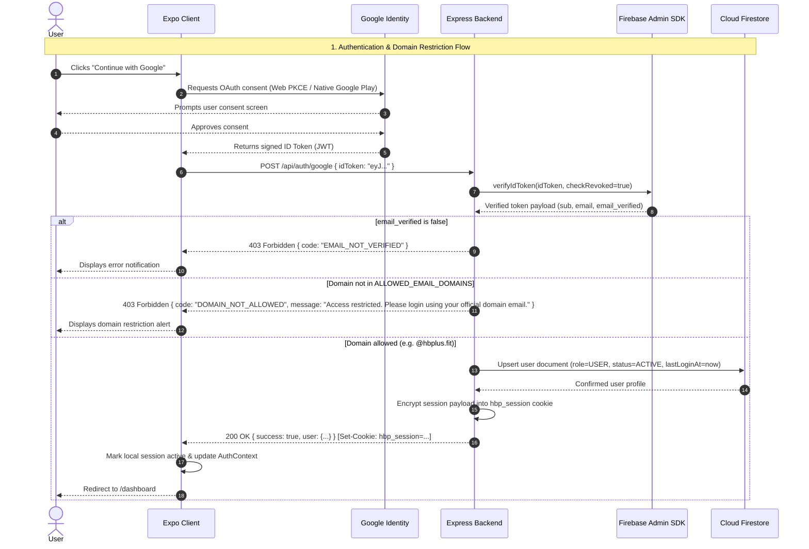
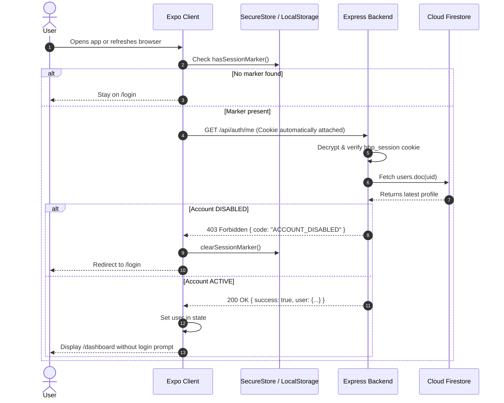

# Authentication Flow

The authentication architecture separates the responsibilities of identity assertion (Google), identity verification and policy enforcement (Node.js backend), and session persistence.



## 1. Successful Login (Authorised Domain)

1. **User Action**: The user clicks **Continue with Google** on the login page (`/login`).
2. **OAuth Authorization**: The client invokes the platform-appropriate Google OAuth handler (see [Web vs. Native](#web-vs-native-oauth-implementation)).
3. **ID Token Generation**: Google issues a signed cryptographic OIDC ID token containing identity claims (`email`, `email_verified`, `sub`, `name`, `picture`).
4. **Token Submission**: The client dispatches a POST request to `http://localhost:4000/api/auth/google` with `{ idToken }`.
5. **Server Verification**: The backend verifies the token using the Firebase Admin SDK (`verifyIdToken`), checking cryptographic signature against Google's JWKS, expiration, and audience. If native verification falls back, it validates the token against Google's OAuth2 endpoints via `google-auth-library`.
6. **Domain Assertion**: The backend verifies `email_verified === true` and extracts the email domain. It checks that the domain exists in `ALLOWED_EMAIL_DOMAINS`.
7. **Firestore User Upsert**:
   - **First login**: Creates a new user document in the `users` collection with `role: "USER"`, `status: "ACTIVE"`, `createdAt`, and `lastLoginAt`.
   - **Subsequent logins**: Updates `lastLoginAt` and refreshed profile info using `{ merge: true }`, ensuring roles and account status set by administrators are never overwritten.
8. **Session Sealed**: An encrypted `hbp_session` cookie is generated via `iron-session` containing the user's `uid` and `role`. The cookie is returned with `HttpOnly`, `SameSite=strict`, and `Secure` (in production).
9. **Navigation**: The client stores a session presence marker and transitions to the protected dashboard (`/dashboard`).

---

## 2. Unauthorised Domain Rejection

When an unauthorized user attempts to log in (e.g. `john.doe@gmail.com` or `hacker@unauthorized.com`):

1. Google grants consent and issues a valid token signed by Google for that user.
2. The client transmits the token to `POST /api/auth/google`.
3. The server validates the Google signature; the identity is legitimate.
4. The server runs `assertAllowedDomain(decoded.email)`.
5. `gmail.com` is compared against `ALLOWED_EMAIL_DOMAINS` (`["hbplus.fit"]`). The check fails.
6. The server rejects the request with HTTP **403 Forbidden**:
   ```json
   {
     "success": false,
     "code": "DOMAIN_NOT_ALLOWED",
     "message": "Access restricted. Please login using your official domain email."
   }
   ```
7. No session cookie is issued. No Firestore document is created.
8. The client displays the exact error message in a visible, dismissible alert banner.

---

## 3. Session Persistence & Rehydration



On application launch or page refresh, `AuthProvider` checks the local storage marker. If present, it makes a background call to `GET /api/auth/me`. The browser sends the HttpOnly `hbp_session` cookie automatically. The server decodes the session, verifies the user is still `ACTIVE` in Firestore, and returns the profile. The user is logged in instantly without showing a login screen flicker.

---

## 4. Session Invalidation & Expiration

- If the session cookie expires (default: 8 hours) or the secret changes, `GET /api/auth/me` returns HTTP 401.
- If an administrator marks a user as `status: "DISABLED"` in Firestore, subsequent API calls immediately fail with HTTP 403 `ACCOUNT_DISABLED`.
- In both cases, the client clears the local session marker and routes the user back to `/login`.

---

## 5. Sign Out

1. The user taps **Logout** or **Sign Out**.
2. The client calls `POST /api/auth/logout`, which instructs `iron-session` to destroy the session cookie on the server.
3. On native platforms, `@react-native-google-signin/google-signin` triggers `GoogleSignin.signOut()`.
4. The local session marker is cleared.
5. The client resets `AuthProvider` state to `user: null`, triggering Expo Router layout guards to redirect to `/(auth)/login`.

---

## Web vs. Native OAuth Implementation

The portal supports seamless authentication across both web and native platforms using conditional native/web adapters in `src/features/authentication/services/googleAuth.ts`:

- **Web Browser**: Uses `expo-auth-session` with the OAuth 2.0 PKCE / ID token flow. It opens a popup to `https://accounts.google.com/o/oauth2/v2/auth`, requests `openid email profile`, and returns an ID token to the callback route `app/auth/callback.tsx`.
- **Android & iOS**: Dynamically imports `@react-native-google-signin/google-signin` to use device-native Google Play Services and system login dialogs, avoiding webview security restrictions.
